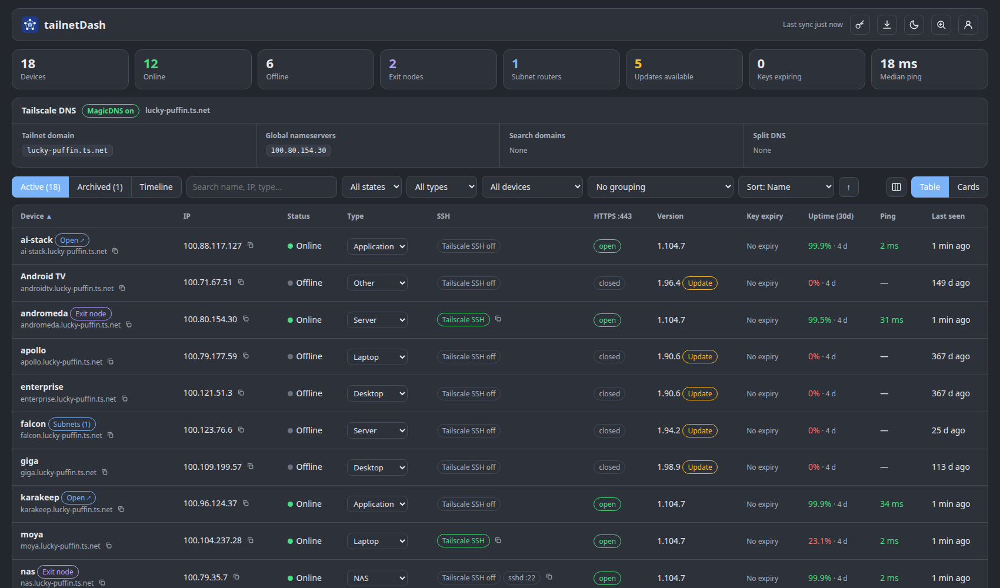
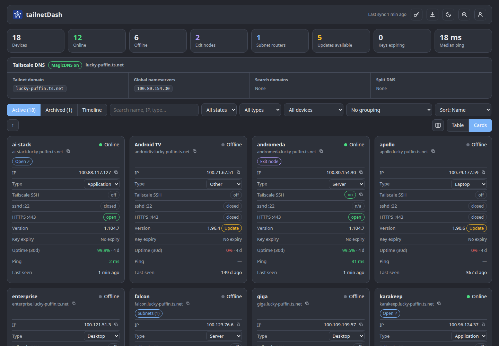

#  tailnetDash

> **Note:** This project is 100% vibe coded with [Claude](https://claude.com/claude-code).

A small self-hosted dashboard for your Tailscale network. It polls the Tailscale API, so new devices
appear and removed ones are archived automatically.

- Per device: IP and name, online state, last seen, Tailscale SSH, sshd on :22, HTTPS on :443,
  client version and update status, key expiry, exit node and subnet router status, uptime
- Archive of removed devices, with their last known details
- Timeline of joins, removals, online/offline changes, version and routing changes
- Types (Server, Laptop…), notes, ping and relay latency, per-device latency history
- Table or card layout, grouping, sortable and configurable columns, light/dark theme, page zoom
- CSV / JSON export and purging of old archived devices
- Login with a username and password you choose on first run, with "remember me"

Stack: Python, Flask, SQLite and one static HTML page. No build step.

**Table view**



**Card view**



## Quick start (Docker)

The dashboard runs as a ready-made image, `ghcr.io/larryni/ts-dash` (amd64 and arm64), with its
own Tailscale sidecar. It joins your tailnet as a machine called `ts-dash` and is served over HTTPS
at `https://ts-dash.<your-tailnet>.ts.net`. Nothing is published on the host, and the host itself
doesn't need Tailscale installed.

You need:

- Docker Engine with Docker Compose **2.23.1 or newer** (`docker compose version`)
- HTTPS enabled for your tailnet: admin console → **DNS** → **HTTPS Certificates**
- A Tailscale **auth key** (admin console → **Settings → Keys → Generate auth key**, starts
  `tskey-auth-`). It adds the `ts-dash` machine to your tailnet. A one-off key is fine.
- A Tailscale **API access token** (starts `tskey-api-`, see [below](#tailscale-api-access-token)).
  You paste this into the dashboard's page later, not into a file.

Get the two files, fill in the auth key and start it:

```sh
mkdir tailnetdash && cd tailnetdash
curl -fsSLO https://raw.githubusercontent.com/larryni/ts-dash/main/docker-compose.yml
curl -fsSL -o .env https://raw.githubusercontent.com/larryni/ts-dash/main/.env.example
chmod 600 .env
nano .env                  # set TS_AUTHKEY=tskey-auth-...
docker compose up -d
```

Open `https://ts-dash.<your-tailnet>.ts.net/` (the first certificate can take up to a minute), then:

1. **Create the login straight away.** Until one exists, whoever opens the page first chooses it.
2. **Paste your API access token** when the page asks for it.

Once the `ts-dash` machine shows up in the admin console, you can delete the `TS_AUTHKEY` value
from `.env`: the machine logs in from `./tailscale-state` from then on.

To update to the newest 1.x release:

```sh
docker compose pull && docker compose up -d
```

More options (machine name, pinning a version, building from source, a variant without the
sidecar) are in [Docker in detail](#docker-in-detail). To run it without Docker, see
[RUN-FROM-SOURCE.md](RUN-FROM-SOURCE.md).

## Docker in detail

[Quick start](#quick-start-docker) covers the usual setup. This section explains what it does and
the alternatives.

Install Docker first, with the Compose plugin **2.23.1 or newer**:

**Arch:** `sudo pacman -S docker docker-compose` then `sudo systemctl enable --now docker`
**Debian / Ubuntu:** install Docker Engine and the Compose plugin from
<https://docs.docker.com/engine/install/>. Distribution packages (`docker.io`,
`docker-compose-v2`) can be older than 2.23.1; check with `docker compose version`.

Settings for `.env` (all optional except the auth key; `.env.example` lists them):

| Variable | Default | Meaning |
|---|---|---|
| `TS_AUTHKEY` | *(none)* | Auth key that adds the machine to your tailnet. Needed on the first start only |
| `TS_HOSTNAME` | `ts-dash` | The machine's name on the tailnet, so the address is `https://<name>.<your-tailnet>.ts.net` |
| `TS_DASH_TAG` | `1` | Image version: `1` follows 1.x releases, `latest` follows every release, or pin an exact one such as `1.0.0` |
| `TS_API_KEY`, `TS_TAILNET`, `POLL_SECONDS`, `PROBE_PORTS`, `ARCHIVE_RETENTION_DAYS` | see [Configuration](#configuration) | Passed through to the dashboard |

- `TS_AUTHKEY` is an **auth key**, not the API access token (which you enter in the page). After
  the machine appears in the admin console, delete the value from `.env`; the node then logs in
  from `./tailscale-state`.
- HTTPS must be enabled for your tailnet (admin console, DNS, HTTPS Certificates). The Tailscale
  Serve settings are inside `docker-compose.yml` (the `configs:` section at the bottom), which is
  why Compose 2.23.1 or newer is needed.
- The dashboard listens on `127.0.0.1` inside the shared network, so it is reachable only through
  Tailscale Serve. `TRUST_PROXY=1` is set so the login lockout counts each client separately and the
  cookie is marked Secure.
- The database, the login and the saved API key live in the `ts-dash-data` volume and survive
  rebuilds. Keep `./tailscale-state` too, or the machine registers again as a new device.
- Pings and :22 / :443 probes leave from the sidecar, straight over the tailnet.
- To use a setting from the configuration table that isn't in the table above (for example
  `CATEGORIES`), add it under `environment:` for the `ts-dash` service in `docker-compose.yml`.

Everyday commands:

```sh
docker compose logs -f ts-dash        # dashboard logs (service `tailscale` for the sidecar)
docker compose restart
docker compose pull && docker compose up -d   # update to the newest release for your TS_DASH_TAG
docker compose down                   # stop (the data volume and tailscale-state are kept)
docker compose exec ts-dash python app.py --reset-login   # forgot the dashboard password
```

**Build from source instead of pulling the image:** clone this repository and layer
`compose.build.yml` over the compose file:

```sh
docker compose -f docker-compose.yml -f compose.build.yml up -d --build
```

**No sidecar?** `docker-compose.host-ts.yml` is a simpler variant that uses the host's own
Tailscale and publishes the dashboard on the host's tailnet IP only (`http://<host>:8080`). Use it
with `cp .env.host-ts.example .env`, set `BIND_IP` to `tailscale ip -4`, and run
`docker compose -f docker-compose.host-ts.yml up -d`. Never publish it on `0.0.0.0`.

## Using the dashboard

### Tailscale API access token

The dashboard reads your device list with a Tailscale **API access token**:

1. Open the Tailscale admin console → **Settings → Keys**.
2. Under **API access tokens**, choose **Generate access token** and copy the `tskey-api-…` value.
3. This is the token the dashboard needs. An auth key (used to add a machine to the tailnet) is a
   different thing and will not work.

You don't need to put the token in a file or environment variable. The first time you open the
dashboard it asks for it, checks it with Tailscale and saves it on the server, apart from the
database. The page never shows it again.

API access tokens expire after at most 90 days. The header warns you two weeks ahead. When a key
expires or is revoked, the dashboard asks for a new one by itself. You can also replace it at any
time with the key button in the header.

The dashboard only reads data. It never changes your tailnet.

### Logging in

- On the very first visit you choose the username and password (at least 8 characters).
- Without **Remember me**, you stay signed in until you close the browser or leave the dashboard
  unused for 12 hours.
- With **Remember me**, the browser stays signed in for 30 days, counted from the last time you used
  it. Leave it off on a shared computer.
- The account menu (the person icon at the right of the header) shows who is signed in and has
  **Change password…** and **Sign out**. Changing the password needs the current one and signs out
  every other browser; the one you are using stays signed in.
- After 5 wrong passwords from one address, each further try has to wait (30 seconds, then longer).

Passwords are stored as a salted scrypt hash, never in plain text. The browser's login cookie is a
random token, and the database keeps only a hash of it.

**Forgot the password?** Run:

```sh
docker compose exec ts-dash python app.py --reset-login
```

This removes the login and signs every browser out (your devices, history and API key are kept).
The next visit asks you to create a new login. Running from source, see
[RUN-FROM-SOURCE.md](RUN-FROM-SOURCE.md#4-run-it).

## Configuration

All settings are environment variables.

| Variable | Default | Meaning |
|---|---|---|
| `TS_API_KEY` | *(none)* | Optional. Used only when no key has been saved from the page yet |
| `KEY_PATH` | `api_key` next to `DB_PATH` | Where the key entered in the page is saved |
| `TS_TAILNET` | `-` | Tailnet name; `-` means your default tailnet |
| `HOST` / `PORT` | `0.0.0.0` / `8080` | Address and port to listen on |
| `POLL_SECONDS` | `60` | How often to ask the Tailscale API for devices |
| `DB_PATH` | `dashboard.db` | SQLite file (relative to where you start the app) |
| `PROBE_PORTS` | `1` | `0` turns off the :22 / :443 probes and ping |
| `CATEGORIES` | `Application,Server,NAS,Desktop,Laptop,Phone,Tablet,Other` | Choices in the Type drop-down, comma separated |
| `EVENT_RETENTION_DAYS` | `365` | How long timeline events are kept |
| `LATENCY_SAMPLE_SECONDS` | `300` | How often latency is recorded |
| `LATENCY_RETENTION_DAYS` | `30` | How long latency history is kept |
| `ARCHIVE_RETENTION_DAYS` | `0` | Automatically purge archived devices after this many days (`0` = never) |
| `TRUST_PROXY` | *(off)* | `1` reads the client address and https from `X-Forwarded-*` headers. Only for a reverse proxy on the same machine that is the sole way in (the Docker sidecar sets it) |

## Updating

```sh
docker compose pull && docker compose up -d
```

The database is upgraded automatically and keeps your history. Then hard-refresh the page
(Ctrl+Shift+R). Running from source, see [RUN-FROM-SOURCE.md](RUN-FROM-SOURCE.md#updating).

## Backup

Everything the dashboard stores (archive, types, notes, timeline, latency) is in one SQLite file,
`dashboard.db`, in the `ts-dash-data` volume. To copy it into the current folder (the volume's full name is
`<project folder>_ts-dash-data`, so `tailnetdash_ts-dash-data` with the quick start; check with
`docker volume ls`):

```sh
docker run --rm -v tailnetdash_ts-dash-data:/data -v "$PWD":/backup alpine cp /data/dashboard.db /backup/
```

The API key is kept apart, in the `api_key` file, so backups of the database don't contain it.
The database does hold the login (as a password hash), so restoring a backup also restores the
password that was set at the time.

## Troubleshooting

Problems specific to running without Docker are in
[RUN-FROM-SOURCE.md](RUN-FROM-SOURCE.md#troubleshooting).

| Symptom | Cause and fix |
|---|---|
| "API key rejected" in the header | Token is wrong, revoked or expired (90-day limit). Generate a new one and enter it with the key button. |
| Forgot the dashboard password | See [Logging in](#logging-in). |
| "Too many wrong attempts" | Wait the number of seconds shown, or restart the dashboard to clear the counter. |
| Asked to create a login after updating | Expected once: versions with a login ask you to set one up on the first visit. |
| Everything shows SSH/HTTPS closed or no ping | The dashboard's machine (the sidecar, with Docker) isn't on the tailnet, or a firewall blocks it. Check `docker compose exec tailscale tailscale status`. |
| Docker: sidecar is "unhealthy", log says `invalid key: API key does not exist` | `TS_AUTHKEY` is empty, a placeholder or the API token. It must be an auth key (`tskey-auth-…`). Fix `.env`, then `docker compose down && rm -rf tailscale-state && docker compose up -d`. |
| Docker: Compose rejects the file, mentioning `configs` or `content` | Docker Compose is older than 2.23.1. Update the Compose plugin (see [Docker in detail](#docker-in-detail)). |
| Docker: `manifest unknown` or `not found` when pulling `ghcr.io/larryni/ts-dash` | `TS_DASH_TAG` names a version that doesn't exist. Use `1`, `latest` or an exact released version. |
| Page looks wrong colours | Some browser extensions (dark-mode or colour changers) restyle pages. Try a private window. |

## Notes on what the columns mean

- **SSH** shows Tailscale SSH as reported by the Tailscale API. "sshd :22" is a separate probe of
  an ordinary SSH server on port 22.
- **HTTPS :443** is only a port probe: it shows that something answers on 443, not that
  `tailscale cert` is set up. The API does not expose certificate status.
- **Ping** is the TCP connect time from the dashboard machine to the device on port 22 or 443,
  not an ICMP ping. A device that blocks both ports shows "no reply".
- **DERP relay** is the device's own latency to its nearest Tailscale relay server.
- Whether a machine accepts subnet routes is not exposed by the API, so the dashboard only shows
  routes a device advertises and whether they are approved.
- Uptime needs about an hour of tracked data before it shows a figure. Time while the dashboard
  itself wasn't running is excluded.
